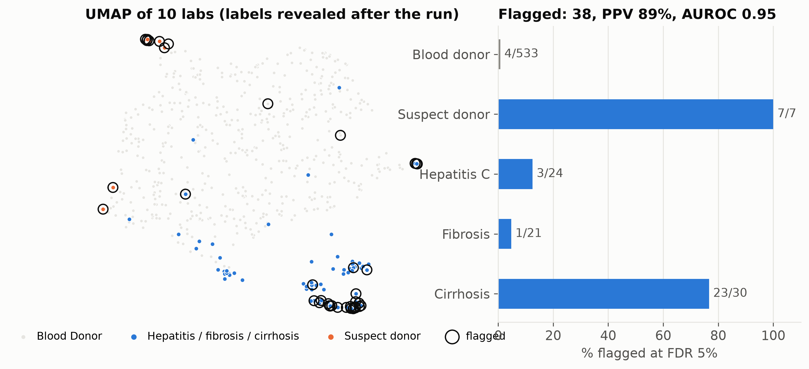
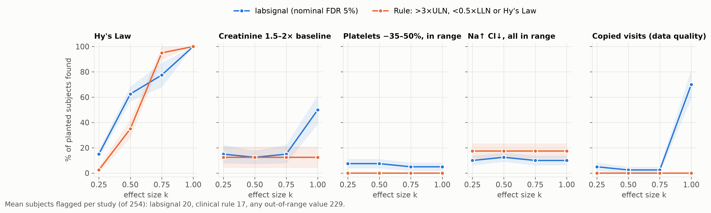
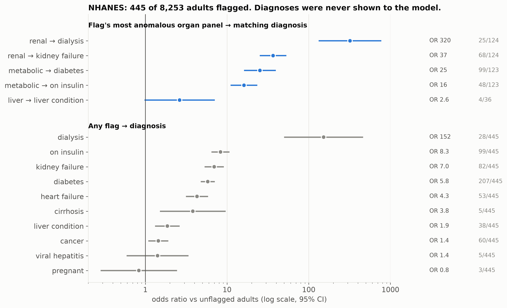

# Privacy-Preserving Local Unsupervised Signal Detection in Clinical Laboratory Data

`labsignal` is a local, LLM-free, unsupervised tool for finding atypical subjects in large lab datasets (ADLB or any long-format lab table). Patient-level data never leaves the machine: no API calls, no tokens, no telemetry.

Presented at BBSW 2026 (Foster City, CA) by Kapil Sardiwal, Manager, Biostatistics, Kite Pharma, a Gilead Company. All results below use public data only.

```
lab records ──► subject features ──► organ-panel detectors ──► calibrated flags ──► explanations
(ADLB or any     peak/trough xULN,    Isolation Forest, LOF,    Cauchy combination,   panel + top labs
 long table)     rise/fall vs base,   robust-PCA score and      parametric-bootstrap  (SHAP), UMAP map,
                 within-subject CV,   orthogonal distance in    null, BH-FDR          HDBSCAN phenotypes
                 data-quality signals each panel + all labs
```

## Quick start

```bash
python3.11 -m venv .venv
.venv/bin/pip install -e ".[app,experiments]"
.venv/bin/labsignal my_adlb.xpt --out out/          # command line
.venv/bin/streamlit run app.py                      # dashboard on localhost
```

Input can be `.xpt`, `.sas7bdat`, `.csv` or `.parquet`. ADLB column names (`USUBJID`, `PARAMCD`, `AVAL`, `ADY`, `A1LO`, `A1HI`, `ABLFL`) are detected automatically. Other long formats need only subject, lab and value columns; override detection with `--subject-col`, `--param-col` and similar flags.

Each run writes `subject_scores.csv`, `flagged_subjects.csv` and `run_manifest.json`. The manifest records the input file's SHA-256, the column mapping, the full config and seed, package versions, timings and `network_calls: 0`, so any run can be reproduced and audited.

## How flags are decided

A fixed "flag the top 8%" cutoff always flags 8%, even on clean data. labsignal asks how surprising each subject is compared with data that has no anomalies:

1. **Features** (longitudinal): per lab, `peak` = log(max/ULN), `trough` = log(min/LLN), `rise` and `fall` = log(post-baseline max or min / baseline), and `cv`, the within-subject coefficient of variation. Trajectory features need at least 3 post-baseline values. Data-quality features: `DQ_repeat`, the share of values identical to the previous visit, and `DQ_cvmed`, the median CV. Cross-sectional data uses the values themselves, log-transformed when right-skewed.
2. **Panels**: liver, renal, electrolytes, metabolic, RBC, WBC/platelets, variability, data quality, plus all features together. A signal in two labs isn't diluted by 30 unrelated ones. Panels with fewer than 3 features are covered only by the all-features set.
3. **Detectors per panel**: Isolation Forest, LOF, and robust-PCA score distance and orthogonal distance (Hubert et al. 2005). Each score becomes an empirical p-value against a Gaussian-copula reference drawn from the bulk of the panel, with a generalized Pareto tail.
4. **Combination**: Cauchy combination test (Liu and Xie 2020), valid under dependence.
5. **Calibration**: parametric bootstrap. The whole pipeline is rerun on synthetic same-size datasets drawn from a Gaussian copula of the data, with the most atypical 10–25% removed (adaptive). Subjects are flagged by Benjamini–Hochberg at a nominal FDR (default 5%).
6. **Structure**: UMAP into 10 dimensions, then HDBSCAN for phenotype clusters; a 2-D UMAP for display.

**Calibration is approximate.** On synthetic data with nothing to find, 1.2–2.0% of subjects are still flagged (`results/calibration_summary.json`), because the bootstrap null is built from trimmed data. Treat the FDR as nominal and the flags as a ranked triage list.

## Results on public data

| Experiment | Data | Result |
|---|---|---|
| Hidden liver disease | UCI HCV, 615 people, 10 labs | 38 flagged, 89% with liver disease; AUROC 0.95; all 7 suspect donors and 23/30 cirrhosis found |
| Planted patterns | CDISC/PHUSE pilot ADLB, 254 subjects, 35 labs, 53k records | Beats range rules on sub-threshold Hy's Law (62% vs 35% at k = 0.5), creatinine 1.5–2× baseline (50% vs 12%) and copied visits (70% vs 0%). Mostly misses within-range platelet and Na/Cl drifts |
| Real population | NHANES 2017–Mar 2020, 8,253 adults, 43 analytes | 28 of 31 dialysis patients flagged; renal-panel flags 55% kidney failure vs 3%; metabolic-panel flags 80% diabetes vs 14% |
| Scale | NHANES resampled | 50,000 subjects × 43 labs (2.15M values) in 4 min, 1.2 GB peak, on a laptop |





## Reproduce

```bash
scripts/get_data.sh                                          # downloads public data to data/raw/
export PYTHONPATH=.
.venv/bin/python experiments/01_hcv_ground_truth.py
.venv/bin/python experiments/02_adlb_spikein.py              # ~1 h on a laptop
.venv/bin/python experiments/prep_nhanes.py && .venv/bin/python experiments/03_nhanes_population.py
.venv/bin/python experiments/04_calibration.py
.venv/bin/python experiments/05_scaling.py
.venv/bin/python experiments/06_figures.py
.venv/bin/python -m pytest tests                             # smoke test, ~30 s
```

Summaries are in `results/`. Per-subject outputs are written there too but are not committed.

## Data sources

- CDISC SDTM/ADaM Pilot Project, via the PHUSE Test Data Factory: <https://github.com/phuse-org/TestDataFactory>
- UCI HCV data (Hoffmann et al. 2018, CC BY 4.0): <https://archive.ics.uci.edu/dataset/571/hcv+data>
- NHANES 2017–March 2020 pre-pandemic (CDC/NCHS, public domain): <https://wwwn.cdc.gov/nchs/nhanes/continuousnhanes/default.aspx?Cycle=2017-2020>

## References

McInnes, Healy & Melville (2018) UMAP · Campello, Moulavi & Sander (2013) HDBSCAN · Liu, Ting & Zhou (2008) Isolation Forest · Breunig et al. (2000) LOF · Hubert, Rousseeuw & Vanden Branden (2005) ROBPCA · Liu & Xie (2020) Cauchy combination test · Benjamini & Hochberg (1995) · Knijnenburg et al. (2009) GPD tail p-values · Lundberg & Lee (2017) SHAP.

## Contact

Kapil Sardiwal · kapil.sardiwal@gilead.com

## License

MIT. See [LICENSE](LICENSE).
